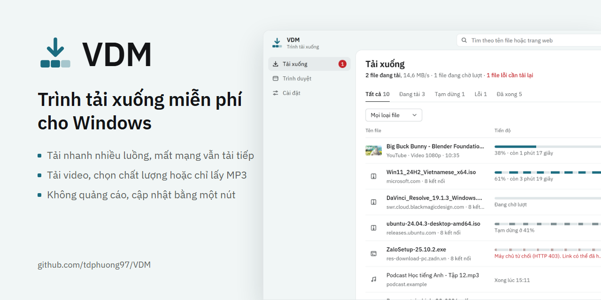
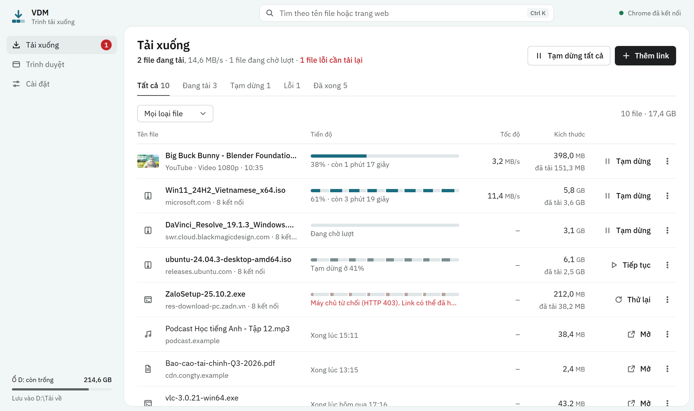
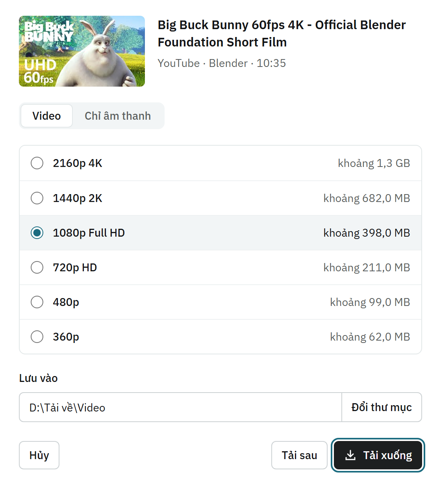
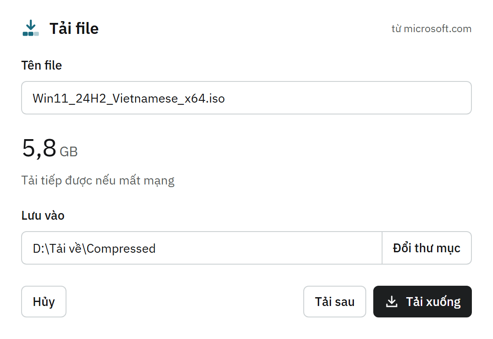

  

<h1 align="center">VDM — trình tải xuống miễn phí cho Windows</h1>

  Tải file lớn nhanh hơn, mất mạng vẫn tải tiếp, tải video và chỉ lấy âm thanh. 
  Miễn phí, không quảng cáo, không tài khoản, không thu thập dữ liệu.

  <a href="../../releases/latest"><b>⬇ Tải VDM bản mới nhất</b></a>
  &nbsp;·&nbsp; <a href="#cài-đặt">Cài đặt</a>
  &nbsp;·&nbsp; <a href="#câu-hỏi-thường-gặp">Câu hỏi thường gặp</a>
  &nbsp;·&nbsp; <a href="PRIVACY.md">Quyền riêng tư</a>

---

## VDM làm được gì

| | |
| --- | --- |
| **Tải nhanh** | Chia file thành tới 32 phần tải cùng lúc. Nhiều file cùng tải thì chia đều tốc độ. |
| **Tải tiếp** | Mất mạng, tắt máy hay tạm dừng: lần sau tải tiếp từ chỗ dừng, không tải lại từ đầu. |
| **Bắt link từ trình duyệt** | Bấm tải trên web như bình thường, VDM nhận file thay trình duyệt (Chrome, Edge, Cốc Cốc). |
| **Tải video** | Nút "Tải video này" trên video đang phát: chọn chất lượng (360p đến 4K) hoặc chỉ lấy MP3/M4A. |
| **Xếp file gọn gàng** | Tự xếp vào Compressed, Programs, Documents, Video, Music, Picture; nhớ thư mục bạn chọn cho từng loại. |
| **Cập nhật một nút** | Có bản mới thì VDM báo, bấm **Cập nhật ngay** là xong. |

  

  
  &nbsp;&nbsp;
  

## Cài đặt

Cần Windows 10 hoặc 11 (64-bit). Mất khoảng 2 phút, chỉ làm một lần.

1. **Tải bộ cài:** vào [trang bản mới nhất](../../releases/latest), ở mục *Assets* bấm `VDM-Setup-<phiên bản>.exe`.
2. **Chạy bộ cài.** Không cần quyền quản trị.
   Nếu Windows hiện *"Windows đã bảo vệ máy tính của bạn"*: bấm **Thông tin thêm** → **Vẫn chạy**
   (xem [vì sao](#vì-sao-windows-hoặc-phần-mềm-diệt-virus-cảnh-báo)).
3. **Cài extension cho trình duyệt** để VDM bắt link: mở VDM → mục **Trình duyệt** → bấm **Hướng dẫn cài**
   ở dòng trình duyệt bạn dùng, rồi làm theo các bước có hình.

**Cập nhật:** từ bản 1.3.0, VDM tự kiểm tra mỗi ngày. Có bản mới thì bấm **Cập nhật ngay**: VDM tự tải, tự
cài, mở lại, và file đang tải dở được tải tiếp. Tắt được trong **Cài đặt → Cập nhật VDM**.

**Gỡ cài đặt:** Cài đặt Windows → Ứng dụng → VDM → Gỡ cài đặt; sau đó gỡ extension VDM trong trang tiện
ích của trình duyệt.

## Cách dùng

- **File:** bấm tải trên web như bình thường, VDM hiện hộp thoại để đổi tên hoặc nơi lưu rồi tải.
- **Video:** rê chuột lên video, kể cả video trong bảng tin, rồi bấm **Tải video này**.
  Video chỉ người đăng nhập mới xem được thì cần đăng nhập trang đó trên trình duyệt trước.
- **Nhạc đang phát** trên các trang nghe nhạc: bấm **Tải bài này** ở góc dưới màn hình.
- **Link không tự bắt được:** chuột phải vào link → **Tải bằng VDM**, hoặc sao chép link rồi bấm Ctrl+V trong VDM.
- **Muốn trình duyệt tự tải một lần:** giữ phím **Alt** khi bấm tải.

## Câu hỏi thường gặp

#### Vì sao Windows hoặc phần mềm diệt virus cảnh báo?
VDM chưa có chữ ký số (chứng chỉ ký mã tốn vài triệu đồng mỗi năm), nên Windows SmartScreen chưa "quen"
và báo *ứng dụng không xác định*. Một số phần mềm diệt virus cũng hay báo nhầm với trình tải xuống vì chúng
tải file từ Internet. Hãy chỉ tải VDM từ [trang phát hành chính thức](../../releases) và đối chiếu mã
SHA-256 ghi trong từng bản phát hành.

#### Video nào không tải được?
Video có khóa bản quyền DRM (Netflix, FPT Play, VieON, Spotify…) — VDM không vượt qua DRM và sẽ không làm
việc đó. Video riêng tư bạn không có quyền xem cũng không tải được.

#### Tải video bị lỗi?
Các trang video thay đổi thường xuyên. Vào **Cài đặt → Công cụ tải video → Kiểm tra cập nhật ngay**, rồi thử
lại. Vẫn lỗi thì [báo lỗi](../../issues/new/choose).

#### VDM có lấy thông tin của tôi không?
Không. VDM không có máy chủ riêng, không gửi dữ liệu đi đâu. Chi tiết, kể cả từng quyền của extension và
lý do cần nó: [Quyền riêng tư](PRIVACY.md).

#### VDM có mất tiền không?
Không, và sẽ không. Không quảng cáo, không bản trả phí.

## Báo lỗi và góp ý

Dùng [mục Issues](../../issues/new/choose) với mẫu có sẵn (cần một tài khoản GitHub miễn phí). Đừng gửi
mật khẩu, cookie hay thông tin đăng nhập trong báo lỗi.

## Sử dụng hợp pháp

VDM là công cụ, giống trình duyệt: nó tải những gì bạn yêu cầu và **không lưu trữ, không chia sẻ nội dung
nào**. Bạn chịu trách nhiệm tuân thủ luật bản quyền và điều khoản sử dụng của trang web nơi nội dung được
đăng. Chỉ tải nội dung bạn có quyền tải: của chính bạn, được tác giả cho phép, nội dung có giấy phép tự do,
hoặc trong phạm vi pháp luật cho phép sử dụng cá nhân. VDM không vượt qua cơ chế chống sao chép (DRM).

Chủ sở hữu bản quyền có khiếu nại: [mở một Issue "Khiếu nại bản quyền"](../../issues/new/choose); chúng tôi
phản hồi sớm nhất có thể.

## Thương hiệu

VDM là dự án cá nhân, **không liên quan** đến Internet Download Manager (Tonec Inc.), Google, YouTube, Meta,
Facebook, Instagram, TikTok, X hay Microsoft. Các tên này thuộc chủ sở hữu tương ứng và chỉ được nhắc đến để
mô tả trang web VDM làm việc cùng. Video trong ảnh minh họa là phim mở *Big Buck Bunny* © Blender Foundation,
giấy phép [CC BY 3.0](https://creativecommons.org/licenses/by/3.0/).

## Giấy phép

VDM là phần mềm miễn phí, mã nguồn không công khai: dùng và chia sẻ bộ cài thoải mái, xem
[LICENSE](LICENSE). VDM dùng các thành phần mã nguồn mở, liệt kê trong
[THIRD-PARTY-NOTICES.md](THIRD-PARTY-NOTICES.md).
